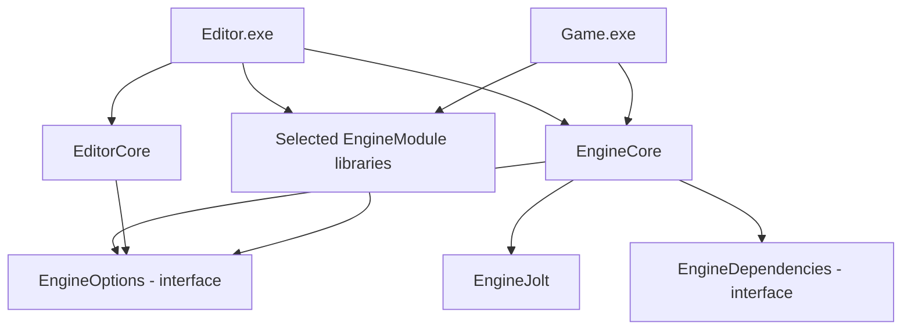
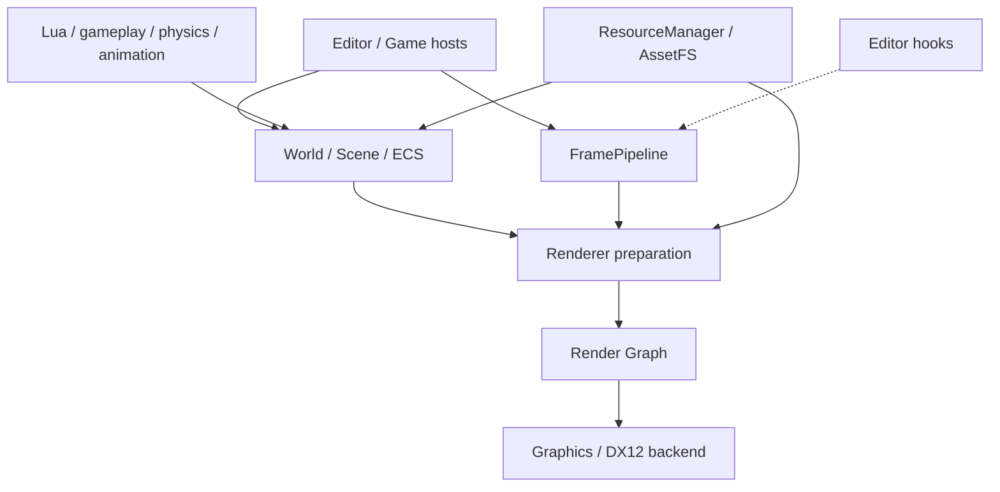
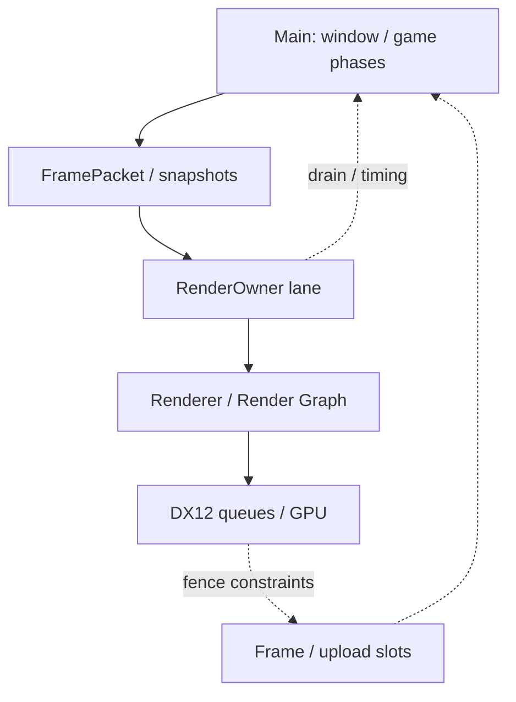

**English** | [日本語](ARCHITECTURE.ja.md)

# Architecture

## Targets and ownership

Arrows show CMake link dependencies. `EngineOptions` and `EngineDependencies` are interface targets, not additional runtime binaries. The default selected module is Nav. Editor owns editor-only UI/import code; Game does not link EditorCore.

EngineCore is compiled without `WITH_EDITOR`. Host differences use host policy or editor hooks. EditorCore compiles editor code with `WITH_EDITOR` and its ImGui definitions.

`main.cpp`, `App.cpp`, `App_Render.cpp` and the generated module registration unit are compiled separately for Editor and Game. App declarations and module registration differ between hosts, so compiling those files once in a shared library would break their layout contract. Each target builds its own PCH.

Jolt is built from source. Its feature definitions must agree with every consumer of Jolt headers; CMake propagates them consistently.

## Source selection

Configure runs `DX12/tools/cmake_configure.py`. The generator reads source-ownership rules and module descriptors to write `Sources.cmake` and registration code in the build tree. It does not invoke MSBuild or parse original project files to compile targets.

New `.cpp` files under `src/` are discovered on CMake's next configure. Module ownership comes from `src/Modules/*.module.json`. Editor helpers outside `src/Editor/` have explicit ownership rules.

## Frame execution

App owns startup, shutdown and the outer loop. FramePipeline coordinates frame phases, including editor hooks. ECS systems update scene data before the renderer prepares GPU-facing draw, material, light and visibility data.

Render Graph describes passes and resource dependencies. Graphics creates DX12 objects, records commands and submits device work. CPU preparation, graph scheduling and GPU submission are separate responsibilities.

### Runtime layers

This is a responsibility map. Scene/gameplay state belongs to the world-facing side; pass/resource scheduling belongs to Render Graph; device objects and command submission belong to Graphics. Editor hooks connect authoring work without introducing `WITH_EDITOR` into EngineCore.

### Frame ownership and synchronization

This illustrates the render-owner path, not an instruction to run every system serially. Jobs and preparation can overlap according to the active frame plan. A drain waits for the required ownership boundary; it does not mean all queued GPU work has completed. Slot reuse is separately guarded by GPU completion.

See [FramePipeline](../DX12/include/Renderer/FramePipeline.h), its [executor](../DX12/src/Renderer/FramePipeline.cpp) and [App render phases](../DX12/src/App_Render.cpp). Keep world mutation, render snapshots and slot ownership on their intended side of the handoff.

## ECS and lifetime

Component pools provide storage; systems declare access for legal parallel batches. Transform hierarchy propagation and world teardown are part of that contract. A cached handle does not survive a scene transition merely because its integer index is reused.

## Resource boundaries

| Root | Ownership |
| --- | --- |
| `DX12/engine/` | Defaults, primitives, LUTs and editor fonts |
| `DX12/asset/` | Project content; only boot/input configuration in this edition |
| `DX12/shaders/` | Built-in renderer implementations |
| `DX12/external/` | Third-party source and required prebuilt payload |
| `DX12/build/` | Generated files, compiler outputs and packages |

Runtime handles track loading/lifetime; GUIDs identify authored resources across moves. Keep `.meta` sidecars and use the engine codec for native binary formats.

## Configuration

`game.json` declares identity, scenes, startup and runtime modules. `engine.json` contains developer/render configuration. `settings.json` stores player options; `settings.default.json` is the clean installation/test template. Editor preferences and layout are local state.

CMake selects what is linked. The project manifest selects what is enabled. Both must agree when adding an optional integration.

## Extension points

- Add engine functionality in EngineCore, editor windows/importers in EditorCore and integrations through modules.
- Declare Render Graph access and maintain CPU/HLSL layout agreement.
- Preserve ECS access declarations and world-lifetime handling.
- Keep project headers out of the PCH; external and C sources do not consume the engine C++ PCH.

See [Engine Systems](ENGINE.md), [Rendering](RENDERING.md) and [Build](BUILD.md).

## Source map

| Area | Starting point |
| --- | --- |
| Application and boot | [main.cpp](../DX12/src/main.cpp), [App.cpp](../DX12/src/App.cpp) |
| Frame execution | [FramePipeline.h](../DX12/include/Renderer/FramePipeline.h) |
| ECS and scheduling | [ECS](../DX12/include/ECS/ECS.h), [Scheduler](../DX12/include/ECS/Scheduler.h) |
| Resource loading | [ResourceManager](../DX12/include/Resource/ResourceManager.h), [AssetFS](../DX12/include/Resource/AssetFS.h) |
| Rendering graph | [RenderGraph](../DX12/include/RenderGraph/RenderGraph.h) |
| Native CMake targets | [DX12/CMakeLists.txt](../DX12/CMakeLists.txt) |

## Where to add a feature

| Change | Main integration points |
| --- | --- |
| Component/system | Storage, serialization/reflection, scheduler registration and access declarations |
| Render feature | Frame-plan selection, resource declarations, shader bindings and lifetime |
| Asset format | Loader/importer, versioned codec, identity and editor integration |
| Editor tool | EditorCore ownership, undo/redo, world/preview lifetime and host hooks |
| Optional module | Descriptor ownership, CMake selection, SDK checks and runtime manifest |

Start with the smallest relevant extension point and verify it in both hosts when shared behavior changes. The diagrams describe current responsibilities, not a requirement to create new managers for every feature.
