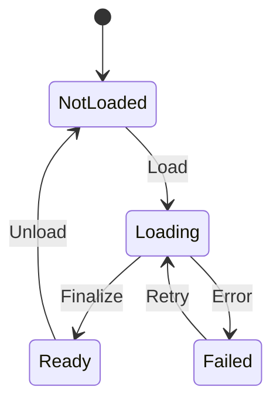

[English](ENGINE.md) | **日本語**

# Engine Systems

## ECS と scheduling

ECS は component を pool に格納し、compact entity reference を使用します。system がアクセスを宣言し、scheduler が合法な並列 batch を構成します。scene teardown 後は world-owned handle や cached pointer が無効になるため、transition 後に取得し直します。

hierarchy propagation は storage と別の責任です。parenting は world transform、serialization、editor operation に影響します。Renderer が受け取る transform は伝播後の frame state であり、直前に編集した local Transform と必ずしも同じではありません。

## Native resources

GUID と meta sidecar は authored file を識別し、runtime handle は loading と lifetime を管理します。非同期処理には decode、upload、finalization が含まれます。handle を受け取った時点では resource が ready とは限りません。

| Format | 用途 |
| --- | --- |
| .iscene | entity/component world scene |
| .iscn、.meshlib | model hierarchy と geometry |
| .ipfb | prefab |
| .itex | texture container |
| .imat、.imatinst、.imatgraph | material、instance、graph |
| .iskel、.ianim | skeleton と animation |
| .iui | UI document |
| .iseq | Sequencer asset |
| .ipak | packaged resource container |

native format は versioned header/metadata を持ち、binary payload を含む場合があります。全ファイルへの text replacement ではなく editor または native codec を使用します。import pipeline は texture/model、PMX/VMD、VRM、animation/skeleton data、Unreal scene input を扱いますが、それらの asset 自体は含みません。

### Resource loading lifecycle

ResourceManager::ResourceState を用いて主な load/retry 経路を示します。loading/failure 中の unload でも、下記のように handle を無効化します。load request は ready 前に handle を返します。一部は deferred GPU finalization を必要とし、texture/mesh subsystem に追加の GPU-readiness state がある場合もあります。file read の成功だけで draw 可能と判断せず、利用側が必要とする状態を確認してください。

| Reference | 有効範囲と責任 |
| --- | --- |
| Asset GUID + meta | ファイル移動を越えて保存する authored identity |
| Resource Handle | slot generation で管理。unload/recycle 後は stale |
| Borrowed Resource pointer | query 中の短い参照。unload や frame を越えて保持しない |
| Entity/world reference | session/world の寿命。scene change 後は取り直す |

[ResourceManager.h](../DX12/include/Resource/ResourceManager.h)を参照してください。loading 中の unload は slot を無効化し、遅れて完了した worker の結果が再利用後の resource に書き込まれることを防ぎます。

## Content と scenes

engine/ に defaults、primitive geometry、BRDF LUT、starter scene、必要な font を置きます。asset/ は project-owned content です。本版は空の boot manifest と Keys/Pad/InputContexts configuration のみを含むため、元の gameplay service や scene script は boot しません。

game.json が scene name を登録し startup を選択します。scene は script と scene-scoped system を参照できます。game-flow state と transition は registry の上にあり、startup で即座に world を読む代わりに state が初回 world を要求する場合もあります。

starter は player controller、enemy、quest、title screen を作りません。別 project の name を load する前に自分の scene を登録します。ファイル移動時は resource identity sidecar を保持してください。

## Settings

| File | 用途 |
| --- | --- |
| game.json | identity、scene、startup、runtime module |
| engine.json | developer/render configuration |
| settings.json | player option |
| settings.default.json | clean installation/test の defaults |
| input_profiles.json | input profile |
| editor_prefs.default.ini、imgui.default.ini | local editor state の seed |

runtime settings には typed row と policy layer があります。scene state、override、command-line pin で値が変わるため、保存 JSON だけで現在の Renderer 設定を判断できません。

## Input と character control

Input は keyboard/mouse、controller state、action binding、mapping context を提供します。Keys/Pad が安定した Lua name を公開し、InputContexts が gameplay/menu mapping を重ねます。context の push/pop を対応させてください。

character control は decision/intent と物理的な移動を分離します。locomotion と animation driver がその state を利用します。関連 source はありますが、starter に character は自動生成しません。

## Cameras

Camera component/controller が editor navigation、runtime view、camera selection を扱います。Edit camera と playing world の selected camera は異なります。screenshot/preview がどの view から得られたかを識別してください。

## Animation と retargeting

GPU skinning、morph、state/blend system、notify、IK、socket、secondary chain motion を含みます。skeleton name と transform が重要で、clip を load できても別 skeleton との互換性は保証されません。

humanoid tool は target rig に motion を mapping/bake します。retarget は任意の clip を runtime で交換可能にする仕組みではありません。model/animation library は収録していません。

## Physics

Jolt が rigid body と character-controller primitive を提供します。engine は collision layer、contact/event、scene lifetime、transform 同期を管理します。CMake は利用側と同じ feature 定義で Jolt をビルドします。

collision shape と visible mesh は別の authoring data です。render geometry の交換だけでは適切な collision は生成されません。

## Navigation と AI

Nav は Recast/Detour を利用し標準で link します。project navmesh は含まないため、自分の scene 用に bake/import します。

AI は behavior、intent、update/LOD の仕組みを持ちます。元の action-library script は除外し、該当 script module も無効です。content なしで有効化する設定は適切ではありません。

## Lua

Lua/sol2 が binding、component access、callback、service/system を提供します。asset/scripts/script_manifest.json が boot entry を宣言し、starter の array は空です。core input configuration は binding 初期化で別途読み込みます。

受け付ける name/type は現在の source/runtime schema で確認します。SDK entity reference の session/world 情報を保ち、scene switch 後に integer ID だけで再利用しないでください。

## Audio と optional media

Audio は XAudio2/X3DAudio を resource loading、mixing、spatial emitter/listener と統合します。音源は利用者が用意し、game music や sound library は含みません。

Media/Video は decode と presentation、FaceTracking は camera/video/network source、mapping、runtime integration を扱います。標準では無効で、対応する FFmpeg/ONNX Runtime payload と authored content が必要です。face model/mapping も含みません。

## Sequencer と timelines

Sequencer asset は timeline evaluation と target resolution を所有します。editor で track を作成し、runtime evaluation は frame lifecycle に参加します。world change 後は target を解決し直します。animation notify や effect/audio event もその寿命を守ります。

## UI と fonts

UI document は、すべての interface を scene code に埋め込む代わりに authored hierarchy を表します。runtime text は font library、editor UI は Noto Sans、CJK face、Font Awesome を使用します。

旧 default path engine/font/FGMiraiRen.ttf の内容は、本版では Noto Sans Regular です。OFL を添付し、元 project の広い font collection を複製せず起動できる構成にしています。

## Editor

docking editor は Outliner、Inspector、Content Browser、viewport tool、undo/redo、Edit/Play を提供します。F11 で docking/full viewport を切り替えます。

| 領域 | Tools |
| --- | --- |
| Scenes | hierarchy、transform、property、undo/redo |
| Materials | material/instance、graph authoring、preview |
| Resources | Texture Viewer、mesh/model、skeleton inspection |
| Animation | set、retarget、secondary motion、timeline |
| Presentation | UI document、font、VFX、Sequencer |
| Diagnostics | Graphics settings、Render Graph、profiler、debug target |

非同期 authoring は結果が可視になる前に job を返す場合があります。依存する inspect/save の前に完了を待ちます。Play 停止時は simulation を誤って保存せず、editing world を復元する必要があります。

## Diagnostics と extension

bounded run は ledger、per-frame evidence、log、任意の capture/state を出力します。CTest は exit code に加えてこれらを確認します。local control channel は runtime で opt-in し engine binding を評価するため sandbox ではありません。status 応答だけで frame 進行を判断しないでください。

拡張時は ownership、reflection/serialization、CPU/GPU layout、lifetime の契約を合わせます。新しい動作には独立した fixture を追加します。starter startup test はゲーム全体を検証するものではありません。
