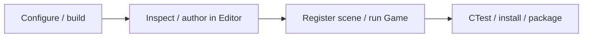

**English** | [日本語](GETTING_STARTED.ja.md)

# Getting Started

This walkthrough covers the first source build, scene-authoring workflow and a separate Game run. Use [Build](BUILD.md) for dependencies/options and [Status](STATUS.md) for the tested scope.

## Workflow



## 1. Build and open the editor

From the repository root:

```powershell
cmake --preset vs-x64
cmake --build --preset vs-x64-release
Set-Location DX12
& .\build\ci\cmake\vs-x64\bin\Release\Editor.exe
```

Use a working Python interpreter and the x64 VS C++ toolchain. If CMake cannot find either, follow the troubleshooting table in Build before changing project content.

## 2. Inspect the starter

The default BaseScene contains a camera, directional light and cube. F11 switches between the full viewport and docking editor. Select the cube in Outliner, inspect its Transform/material in Inspector and inspect the built-in resources in Content Browser.

There is no character, title screen or original game scene to load. A working starter confirms the core path, not every feature shown in earlier demo videos.

## 3. Author your own scene

Create basic geometry with the editor's Create / 3D Object tools, or import resources you own into the project asset root. Set materials, cameras and lights, then save the scene as a new `.iscene` under `asset/`.

Keep `.meta` files with authored resources and preserve dependent textures/materials. Native files are versioned containers: use the editor/codec rather than editing their binary contents directly. Optional preview environments and game assets are not automatically supplied.

## 4. Register the scene

Merge the relevant fields into the existing `DX12/game.json`; retain its name, version, module and package settings. This example assumes you have already saved `asset/MyScene.iscene`:

```json
{
  "scenes": {
    "BaseScene": { "path": "engine/world/BaseScene.iscene" },
    "MyScene": { "path": "asset/MyScene.iscene" }
  },
  "startup_scene": "asset/MyScene.iscene"
}
```

A registry name and its file path are different. `-scene=MyScene` uses the registration; `startup_scene` selects the normal boot scene. Do not replace the entire project manifest with this partial example.

## 5. Test the Game host

From `DX12/`:

```powershell
& .\build\ci\cmake\vs-x64\bin\Release\Game.exe -scene=MyScene -settings=settings.default.json
```

Editor success alone does not establish Game behavior. Check camera selection, resource readiness and any script lifecycle in the runtime host. Keep CMake's linked-module selection consistent with the runtime manifest before enabling optional code.

## 6. Check and distribute

Return to the repository root for the included startup tests:

```powershell
Set-Location ..
ctest --preset vs-x64-release
```

The included tests deliberately use BaseScene; they do not test MyScene automatically. Add independent evidence for your own scene and inspect the relevant run.json, frames.jsonl, log and screenshot.

Use the install/package commands in [Build](BUILD.md) to create a complete loose-file distribution. Launch it from its installed root so shaders, defaults, content and runtime DLLs resolve together.

## What to read next

| Goal | Guide |
| --- | --- |
| Change compiler/SDK/module options | [Build](BUILD.md) |
| Understand ownership and frame handoff | [Architecture](ARCHITECTURE.md) |
| Work on materials, lighting or passes | [Rendering](RENDERING.md) |
| Work on ECS, resources, animation or tools | [Engine Systems](ENGINE.md) |
| Check available integrations and limits | [Status](STATUS.md) |
