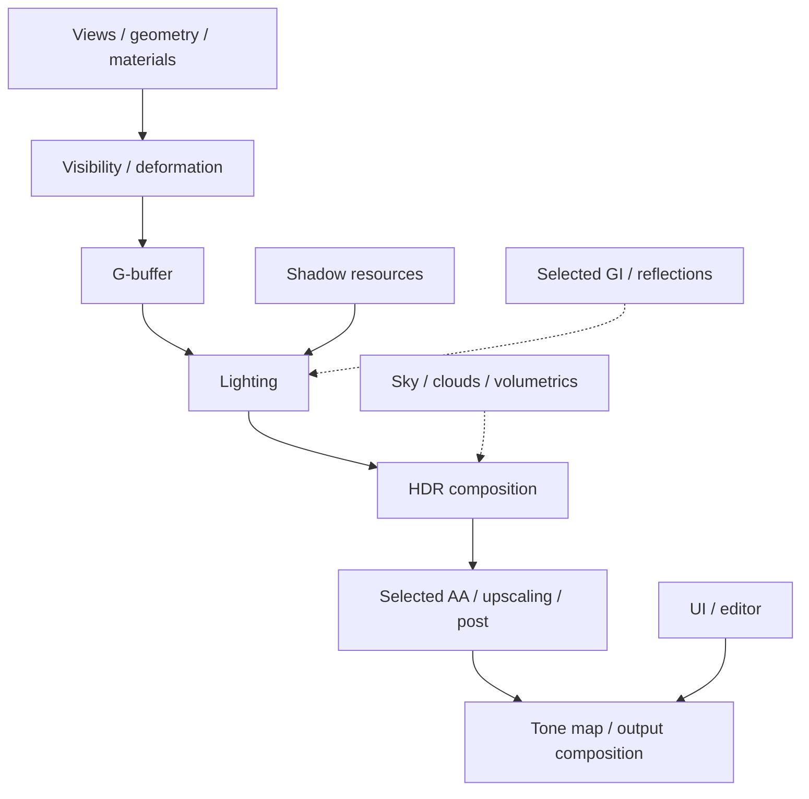

[English](RENDERING.md) | **日本語**

# Rendering Pipeline

## Pipeline structure

Renderer が scene/GPU data を準備し、Render Graph が pass/resource dependency を整理し、Graphics が DX12 work を記録・送信します。CPU preparation、graph scheduling、device execution を分離した構造です。

starter は SDR と保守的な defaults を使用します。以下は保持している実装の説明であり、すべての GPU と mode で検証済みという意味ではありません。

### Feature-level data flow

feature 間の data dependency をまとめた図で、固定の pass order を指定していません。破線は optional input です。active frame plan が render path と対応 feature を選び、Render Graph が具体的な pass/resource 関係を解決します。AA/upscaling、capture/output path により詳細な順序は変わります。

### Source の読み方

frame ownership は [FramePipeline](../DX12/include/Renderer/FramePipeline.h)、graph execution は [RenderGraph implementation](../DX12/src/RenderGraph/RenderGraph.cpp)、個別 pass は本ページ末尾の source index から確認できます。source に feature があっても、starter profile で有効とは限りません。

## Geometry と visibility

bindless resource と format-aware vertex data を使用します。preparation は culling、hierarchy/Hi-Z information、indirect argument、mesh/meshlet path を含みます。skinning/morph はそれらを消費する pass の前に per-frame deformation を準備します。

visible entity count、draw count、device work は異なる指標です。frame 自体が成功していても、material readiness、view mask、visibility setting により mesh が描画されない場合があります。

## G-buffer、lighting、shadows

deferred rendering が material/geometry data を保存し、後段の lighting に渡します。clustered preparation は local light を整理します。directional、point、spot light は異なる shadowing 要件を持ち、cascade、local-light resource、per-object/character path などがあります。

CPU material/light layout は HLSL と一致させます。生成 material offset により raw-buffer read を native data に合わせます。structure だけを変えて shader/serialization 契約を変更しない場合、コンパイルできても画像が誤る可能性があります。

## Reflections と global illumination

screen-space reflection、ray-query fallback、reflection probe、DDGI の実装を保持しています。選択した effect が要求する箇所で NRD を使用します。device capability と active frame plan により実際の経路が決まります。

ReSTIR source は保持していますが、RTXDI/SHaRC SDK tree を同梱せず、依存 backend は default CMake build では無効です。source-level interface の存在は完全な SDK payload の提供を意味しません。

## Atmosphere と volumetrics

atmosphere、time-of-day integration、cloud、height fog、volumetric effect に専用 subsystem があります。外部 HDR environment library は収録していません。starter は内蔵 scene data と利用できる Renderer default を使います。

sun direction/intensity、exposure、environment illumination は相互に影響します。lighting setup として合わせて調整し、一枚の暗い画像だけで shader missing と判断しないでください。

## Anti-aliasing と reconstruction

TAA/FXAA source を収録しています。core FidelityFX loader/upscaler payload を含み、Streamline は別途 SDK/runtime が必要な optional integration です。

temporal path は motion vector、history validity、exposure、resolution に依存します。view lifetime change や mode switch では、関連 history の再初期化が必要です。

## HDR と post processing

SDR/HDR output に対応する実装があり、bloom、depth of field、auto-exposure、grading、sharpening、stylization などを含みます。player option と scene profile が最終結果に寄与します。

capture の解釈には output format と transfer function が関わります。適切な変換なしに SDR PNG を異なる HDR path の数値基準として使用しないでください。

## NPR と characters

NPR は part-specific shading、face/hair treatment、overlay、outline を含みます。適切な mesh、mask、texture slot、material parameter が必要です。character content は提供していません。

## Terrain、grass、water、effects

terrain/grass、water、interactive ripple の仕組みを保持しています。component data と、一部 material では starter にない texture を必要とします。

effect には billboard、trail、tracer、beam、particle、afterimage などがあります。simulation data、frame ownership、Render Graph access の一致を維持してください。VFX showcase scene は含みません。

## Materials と shaders

built-in shader は DX12/shaders/、project custom material は project asset root に置きます。hook、reflected parameter declaration、register space、GPU layout は importer、editor、Renderer が共有する interface です。

material graph は shader implementation を生成します。generated HLSL を一次 asset とするのではなく、graph または authored source を編集します。shader が compile できても resource binding が誤る場合があるため、選択した material と draw を確認してください。

## Views と previews

editor preview は独自の view lifetime と resource cost を持ちます。一部の authoring preview は収録しない秋の IBL library を参照します。同等の reflection が必要な場合は environment を用意します。

## Debugging

検証対象 run の実際の scene、draw evidence、error、capture から調べます。object がない場合は resource readiness と binding を確認します。barrier、order、device work は Render Graph または GPU-frame inspection で調べます。CPU timing だけで GPU bottleneck の位置は決まりません。

CTest startup は bounded execution と frame evidence を確認し、全 shader permutation や optional rendering mode を網羅しません。[Status](STATUS.ja.md)を参照してください。

## Render-pass source index

この配布版に存在する implementation unit の一覧です。ファイルの存在は、すべての frame でその pass が実行されることを意味しません。
| Implementation | Source |
| --- | --- |
| AfterimageCapturePass | [C++](../DX12/src/RenderGraph/RenderPass/AfterimageCapturePass.cpp) |
| AutoExposurePass | [C++](../DX12/src/RenderGraph/RenderPass/AutoExposurePass.cpp) |
| BeamSimPass | [C++](../DX12/src/RenderGraph/RenderPass/BeamSimPass.cpp) |
| BillboardFXPass | [C++](../DX12/src/RenderGraph/RenderPass/BillboardFXPass.cpp) |
| BloomPass | [C++](../DX12/src/RenderGraph/RenderPass/BloomPass.cpp) |
| CASPass | [C++](../DX12/src/RenderGraph/RenderPass/CASPass.cpp) |
| CloudPass | [C++](../DX12/src/RenderGraph/RenderPass/CloudPass.cpp) |
| ClusterPass | [C++](../DX12/src/RenderGraph/RenderPass/ClusterPass.cpp) |
| CullingPass | [C++](../DX12/src/RenderGraph/RenderPass/CullingPass.cpp) |
| DDGIPass | [C++](../DX12/src/RenderGraph/RenderPass/DDGIPass.cpp) |
| DDGIProbeDebugPass | [C++](../DX12/src/RenderGraph/RenderPass/DDGIProbeDebugPass.cpp) |
| DebugIconPass | [C++](../DX12/src/RenderGraph/RenderPass/DebugIconPass.cpp) |
| DebugTargetViewPass | [C++](../DX12/src/RenderGraph/RenderPass/DebugTargetViewPass.cpp) |
| DebugWirePass | [C++](../DX12/src/RenderGraph/RenderPass/DebugWirePass.cpp) |
| DecalPass | [C++](../DX12/src/RenderGraph/RenderPass/DecalPass.cpp) |
| DepthOfFieldPass | [C++](../DX12/src/RenderGraph/RenderPass/DepthOfFieldPass.cpp) |
| DLSSPass | [C++](../DX12/src/RenderGraph/RenderPass/DLSSPass.cpp) |
| EditorGridPass | [C++](../DX12/src/RenderGraph/RenderPass/EditorGridPass.cpp) |
| FaceOverlayPass | [C++](../DX12/src/RenderGraph/RenderPass/FaceOverlayPass.cpp) |
| FSR2Pass | [C++](../DX12/src/RenderGraph/RenderPass/FSR2Pass.cpp) |
| FXAAPass | [C++](../DX12/src/RenderGraph/RenderPass/FXAAPass.cpp) |
| GBufferPass | [C++](../DX12/src/RenderGraph/RenderPass/GBufferPass.cpp) |
| GlassShatterPass | [C++](../DX12/src/RenderGraph/RenderPass/GlassShatterPass.cpp) |
| GrassPass | [C++](../DX12/src/RenderGraph/RenderPass/GrassPass.cpp) |
| HairShadowMarkPass | [C++](../DX12/src/RenderGraph/RenderPass/HairShadowMarkPass.cpp) |
| HeightFogPass | [C++](../DX12/src/RenderGraph/RenderPass/HeightFogPass.cpp) |
| HiZPass | [C++](../DX12/src/RenderGraph/RenderPass/HiZPass.cpp) |
| LensFlarePass | [C++](../DX12/src/RenderGraph/RenderPass/LensFlarePass.cpp) |
| LightingPass | [C++](../DX12/src/RenderGraph/RenderPass/LightingPass.cpp) |
| LightSamplingPass | [C++](../DX12/src/RenderGraph/RenderPass/LightSamplingPass.cpp) |
| LumaReducePass | [C++](../DX12/src/RenderGraph/RenderPass/LumaReducePass.cpp) |
| NPRStabilizePass | [C++](../DX12/src/RenderGraph/RenderPass/NPRStabilizePass.cpp) |
| OutlineGeometryPass | [C++](../DX12/src/RenderGraph/RenderPass/OutlineGeometryPass.cpp) |
| OutlinePass | [C++](../DX12/src/RenderGraph/RenderPass/OutlinePass.cpp) |
| ParticlePasses | [C++](../DX12/src/RenderGraph/RenderPass/ParticlePasses.cpp) |
| PathTraceFogPass | [C++](../DX12/src/RenderGraph/RenderPass/PathTraceFogPass.cpp) |
| PathTracePass | [C++](../DX12/src/RenderGraph/RenderPass/PathTracePass.cpp) |
| PerObjectShadowPass | [C++](../DX12/src/RenderGraph/RenderPass/PerObjectShadowPass.cpp) |
| PickingPass | [C++](../DX12/src/RenderGraph/RenderPass/PickingPass.cpp) |
| PointShadowPass | [C++](../DX12/src/RenderGraph/RenderPass/PointShadowPass.cpp) |
| PreviewStudioShadowPass | [C++](../DX12/src/RenderGraph/RenderPass/PreviewStudioShadowPass.cpp) |
| PTRtxdiCore | [C++](../DX12/src/RenderGraph/RenderPass/PTRtxdiCore.cpp) |
| ReflectionProbeCapturePass | [C++](../DX12/src/RenderGraph/RenderPass/ReflectionProbeCapturePass.cpp) |
| ReSTIRBackend | [C++](../DX12/src/RenderGraph/RenderPass/ReSTIRBackend.cpp) |
| RRGuidePass | [C++](../DX12/src/RenderGraph/RenderPass/RRGuidePass.cpp) |
| RTAOPass | [C++](../DX12/src/RenderGraph/RenderPass/RTAOPass.cpp) |
| RTDIEngineCore | [C++](../DX12/src/RenderGraph/RenderPass/RTDIEngineCore.cpp) |
| RTDIPass | [C++](../DX12/src/RenderGraph/RenderPass/RTDIPass.cpp) |
| RTDIRtxdiCore | [C++](../DX12/src/RenderGraph/RenderPass/RTDIRtxdiCore.cpp) |
| RTGIEngineCore | [C++](../DX12/src/RenderGraph/RenderPass/RTGIEngineCore.cpp) |
| RTGIPass | [C++](../DX12/src/RenderGraph/RenderPass/RTGIPass.cpp) |
| RTGIRtxdiCore | [C++](../DX12/src/RenderGraph/RenderPass/RTGIRtxdiCore.cpp) |
| RTReflectionPass | [C++](../DX12/src/RenderGraph/RenderPass/RTReflectionPass.cpp) |
| RTShadowPass | [C++](../DX12/src/RenderGraph/RenderPass/RTShadowPass.cpp) |
| RtxdiProbe | [C++](../DX12/src/RenderGraph/RenderPass/RtxdiProbe.cpp) |
| SceneVoxelPass | [C++](../DX12/src/RenderGraph/RenderPass/SceneVoxelPass.cpp) |
| ShadowPass | [C++](../DX12/src/RenderGraph/RenderPass/ShadowPass.cpp) |
| SkinningPass | [C++](../DX12/src/RenderGraph/RenderPass/SkinningPass.cpp) |
| SkyboxPass | [C++](../DX12/src/RenderGraph/RenderPass/SkyboxPass.cpp) |
| SkyIBLPass | [C++](../DX12/src/RenderGraph/RenderPass/SkyIBLPass.cpp) |
| SpotShadowPass | [C++](../DX12/src/RenderGraph/RenderPass/SpotShadowPass.cpp) |
| SSGIPass | [C++](../DX12/src/RenderGraph/RenderPass/SSGIPass.cpp) |
| StylizePass | [C++](../DX12/src/RenderGraph/RenderPass/StylizePass.cpp) |
| SurfaceCacheBakePass | [C++](../DX12/src/RenderGraph/RenderPass/SurfaceCacheBakePass.cpp) |
| TAAPass | [C++](../DX12/src/RenderGraph/RenderPass/TAAPass.cpp) |
| TerrainPass | [C++](../DX12/src/RenderGraph/RenderPass/TerrainPass.cpp) |
| TextureViewPass | [C++](../DX12/src/RenderGraph/RenderPass/TextureViewPass.cpp) |
| ToneMapPass | [C++](../DX12/src/RenderGraph/RenderPass/ToneMapPass.cpp) |
| TracerPasses | [C++](../DX12/src/RenderGraph/RenderPass/TracerPasses.cpp) |
| TrailPasses | [C++](../DX12/src/RenderGraph/RenderPass/TrailPasses.cpp) |
| TranslucentFrontLayerPass | [C++](../DX12/src/RenderGraph/RenderPass/TranslucentFrontLayerPass.cpp) |
| TransmissionPasses | [C++](../DX12/src/RenderGraph/RenderPass/TransmissionPasses.cpp) |
| TransparentPass | [C++](../DX12/src/RenderGraph/RenderPass/TransparentPass.cpp) |
| UIPass | [C++](../DX12/src/RenderGraph/RenderPass/UIPass.cpp) |
| UnderwaterPass | [C++](../DX12/src/RenderGraph/RenderPass/UnderwaterPass.cpp) |
| UpscalerReactiveMaskPass | [C++](../DX12/src/RenderGraph/RenderPass/UpscalerReactiveMaskPass.cpp) |
| VelocityFillPass | [C++](../DX12/src/RenderGraph/RenderPass/VelocityFillPass.cpp) |
| VideoPass | [C++](../DX12/src/RenderGraph/RenderPass/VideoPass.cpp) |
| VideoQuadPass | [C++](../DX12/src/RenderGraph/RenderPass/VideoQuadPass.cpp) |
| VolumetricFogPass | [C++](../DX12/src/RenderGraph/RenderPass/VolumetricFogPass.cpp) |
| WaterPass | [C++](../DX12/src/RenderGraph/RenderPass/WaterPass.cpp) |
| WaterSurfacePass | [C++](../DX12/src/RenderGraph/RenderPass/WaterSurfacePass.cpp) |
| WorldUIBillboardPass | [C++](../DX12/src/RenderGraph/RenderPass/WorldUIBillboardPass.cpp) |
| XeGTAOPass | [C++](../DX12/src/RenderGraph/RenderPass/XeGTAOPass.cpp) |
