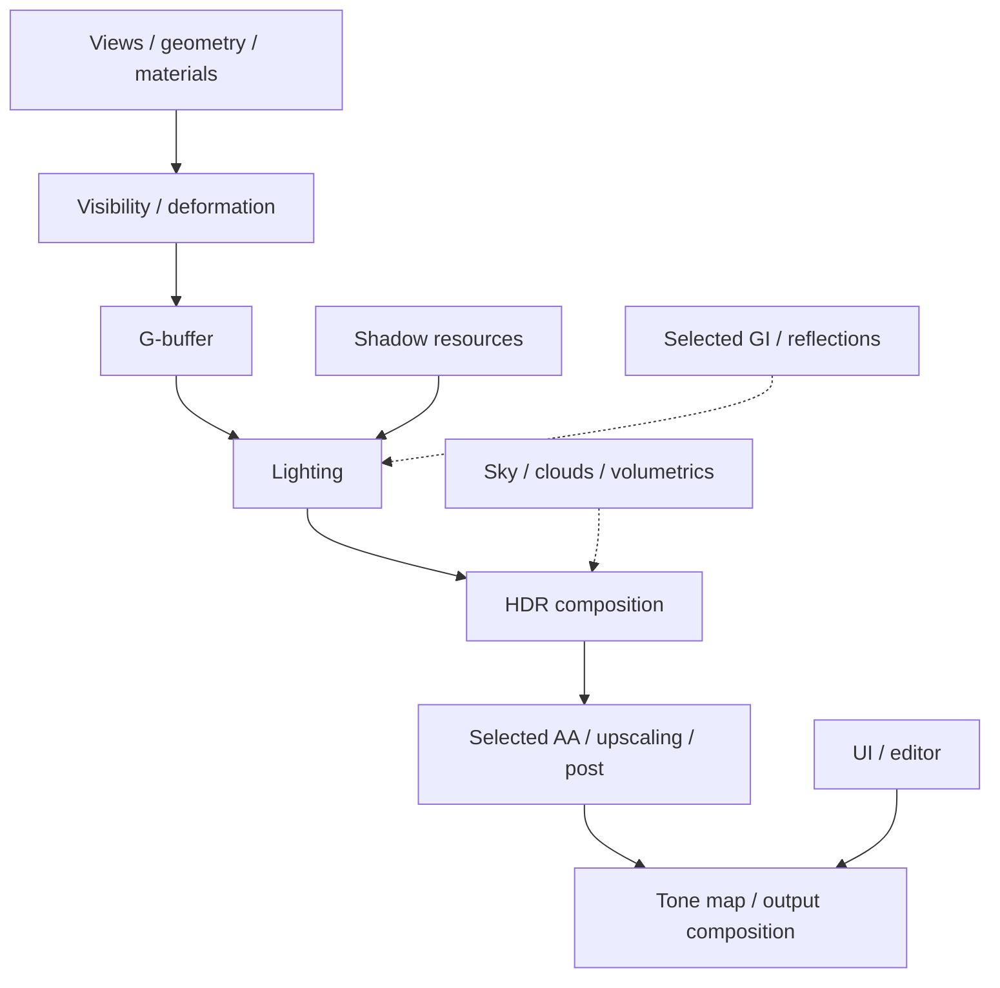

**English** | [日本語](RENDERING.ja.md)

# Rendering Pipeline

## Pipeline structure

Renderer prepares scene/GPU data, Render Graph organizes pass/resource dependencies, and Graphics records/submits DX12 work. Those layers separate CPU preparation from graph scheduling and device execution.

The starter uses SDR and conservative defaults. The areas below describe retained implementation, not validation of every mode on every GPU.

### Feature-level data flow

This groups feature dependencies rather than prescribing a fixed pass order. Optional inputs are dashed. The active frame plan selects the render path and supported features; Render Graph resolves the concrete pass/resource relationships. AA/upscaling choices and capture/output paths can alter the detailed ordering.

### Reading the source

Use [FramePipeline](../DX12/include/Renderer/FramePipeline.h) for frame ownership, the [RenderGraph implementation](../DX12/src/RenderGraph/RenderGraph.cpp) for graph execution and the source index below for pass-specific code. A feature can be present in source without being active in the starter profile.

## Geometry and visibility

The geometry path uses bindless resources and format-aware vertex data. Preparation covers culling, hierarchy/Hi-Z information, indirect arguments and mesh/meshlet paths. Skinning/morphs add per-frame deformation before consuming passes.

Visible entity count, draw count and device work are different measurements. A mesh can be omitted by material readiness, view masks or visibility settings despite an otherwise successful frame.

## G-buffer, lighting and shadows

Deferred rendering writes material/geometry data for lighting. Clustered preparation organizes local lights. Directional, point and spot lights have separate shadowing needs, including cascades, local-light resources and per-object/character paths.

CPU material/light layouts must agree with HLSL. Generated material offsets keep raw-buffer reads aligned with native data. Changing a structure without its shader/serialization contracts can compile and still produce a wrong image.

## Reflections and global illumination

Retained implementations include screen-space reflection logic, ray-query fallbacks, probes and DDGI. NRD is used where the selected effect requests denoising. Device capabilities and the active frame plan determine which paths execute.

ReSTIR source is retained. RTXDI/SHaRC SDK trees are not bundled and their dependent backends are absent from the default CMake build. Their source-level interfaces do not imply a complete SDK payload.

## Atmosphere and volumetrics

Atmosphere, time-of-day integration, clouds, height fog and volumetric effects have dedicated subsystems. No external HDR environment library is included. The starter uses built-in scene data and available renderer defaults.

Sun direction/intensity, exposure and environment illumination interact. Adjust them as a lighting setup rather than treating a single screenshot's darkness as evidence of a missing shader.

## Anti-aliasing and reconstruction

TAA/FXAA source is included. The core FidelityFX loader/upscaler payload is bundled; Streamline is an optional integration requiring its separately acquired SDK/runtime.

Temporal paths depend on motion vectors, history validity, exposure and resolution. View lifetime changes and mode switches must reinitialize the appropriate histories.

## HDR and post processing

Output handling includes SDR/HDR paths. The source includes bloom, depth of field, auto-exposure, grading, sharpening and stylization. Player options and scene profiles contribute to the final result.

Capture interpretation depends on output format and transfer function. An SDR PNG is not a numerical reference for a different HDR path without the appropriate conversion.

## NPR and characters

NPR includes part-specific shading, face/hair treatment, overlays and outlines. These paths need appropriately authored meshes, masks, texture slots and material parameters. Character content is not supplied.

## Terrain, grass, water and effects

Terrain/grass, water and interactive ripple machinery are retained. They need component data and, in some materials, textures absent from the starter.

Effect implementations include billboards, trails, tracers, beams, particles and afterimages. Their simulation data, frame ownership and render-graph access must stay consistent. There is no VFX showcase scene in this checkout.

## Materials and shaders

Built-in shaders live in `DX12/shaders/`. Project custom materials belong under the project asset root. Hooks, reflected parameter declarations, register spaces and GPU layout form an interface shared by importers, editor and renderer.

Material graphs generate shader implementations. Edit the graph or authored source instead of treating generated HLSL as the primary asset. A compiling shader may still have incorrect resource bindings; inspect the selected material and draw.

## Views and previews

Editor previews have their own view lifetime and resource costs. Some authoring previews reference the original autumn IBL library, which is not bundled. Supply your own environment for equivalent reflections.

## Debugging

Start with the actual scene, draw evidence, errors and capture for the run under test. Check resource readiness/bindings for missing objects. Use render-graph or GPU-frame inspection for barriers, ordering and device work. CPU timing does not directly locate a GPU bottleneck.

CTest startup validates bounded execution and frame evidence, not the entire shader permutation space or optional rendering modes. See [Status](STATUS.md).

## Render-pass source index

Implementation units present in this edition are listed below. A file's presence does not mean that pass executes in every frame.

| Implementation | Source |
| --- | --- |
| AfterimageCapturePass | [C++](../DX12/src/RenderGraph/RenderPass/AfterimageCapturePass.cpp) |
| AutoExposurePass | [C++](../DX12/src/RenderGraph/RenderPass/AutoExposurePass.cpp) |
| BeamSimPass | [C++](../DX12/src/RenderGraph/RenderPass/BeamSimPass.cpp) |
| BillboardFXPass | [C++](../DX12/src/RenderGraph/RenderPass/BillboardFXPass.cpp) |
| BloomPass | [C++](../DX12/src/RenderGraph/RenderPass/BloomPass.cpp) |
| CASPass | [C++](../DX12/src/RenderGraph/RenderPass/CASPass.cpp) |
| CloudPass | [C++](../DX12/src/RenderGraph/RenderPass/CloudPass.cpp) |
| ClusterPass | [C++](../DX12/src/RenderGraph/RenderPass/ClusterPass.cpp) |
| CullingPass | [C++](../DX12/src/RenderGraph/RenderPass/CullingPass.cpp) |
| DDGIPass | [C++](../DX12/src/RenderGraph/RenderPass/DDGIPass.cpp) |
| DDGIProbeDebugPass | [C++](../DX12/src/RenderGraph/RenderPass/DDGIProbeDebugPass.cpp) |
| DebugIconPass | [C++](../DX12/src/RenderGraph/RenderPass/DebugIconPass.cpp) |
| DebugTargetViewPass | [C++](../DX12/src/RenderGraph/RenderPass/DebugTargetViewPass.cpp) |
| DebugWirePass | [C++](../DX12/src/RenderGraph/RenderPass/DebugWirePass.cpp) |
| DecalPass | [C++](../DX12/src/RenderGraph/RenderPass/DecalPass.cpp) |
| DepthOfFieldPass | [C++](../DX12/src/RenderGraph/RenderPass/DepthOfFieldPass.cpp) |
| DLSSPass | [C++](../DX12/src/RenderGraph/RenderPass/DLSSPass.cpp) |
| EditorGridPass | [C++](../DX12/src/RenderGraph/RenderPass/EditorGridPass.cpp) |
| FaceOverlayPass | [C++](../DX12/src/RenderGraph/RenderPass/FaceOverlayPass.cpp) |
| FSR2Pass | [C++](../DX12/src/RenderGraph/RenderPass/FSR2Pass.cpp) |
| FXAAPass | [C++](../DX12/src/RenderGraph/RenderPass/FXAAPass.cpp) |
| GBufferPass | [C++](../DX12/src/RenderGraph/RenderPass/GBufferPass.cpp) |
| GlassShatterPass | [C++](../DX12/src/RenderGraph/RenderPass/GlassShatterPass.cpp) |
| GrassPass | [C++](../DX12/src/RenderGraph/RenderPass/GrassPass.cpp) |
| HairShadowMarkPass | [C++](../DX12/src/RenderGraph/RenderPass/HairShadowMarkPass.cpp) |
| HeightFogPass | [C++](../DX12/src/RenderGraph/RenderPass/HeightFogPass.cpp) |
| HiZPass | [C++](../DX12/src/RenderGraph/RenderPass/HiZPass.cpp) |
| LensFlarePass | [C++](../DX12/src/RenderGraph/RenderPass/LensFlarePass.cpp) |
| LightingPass | [C++](../DX12/src/RenderGraph/RenderPass/LightingPass.cpp) |
| LightSamplingPass | [C++](../DX12/src/RenderGraph/RenderPass/LightSamplingPass.cpp) |
| LumaReducePass | [C++](../DX12/src/RenderGraph/RenderPass/LumaReducePass.cpp) |
| NPRStabilizePass | [C++](../DX12/src/RenderGraph/RenderPass/NPRStabilizePass.cpp) |
| OutlineGeometryPass | [C++](../DX12/src/RenderGraph/RenderPass/OutlineGeometryPass.cpp) |
| OutlinePass | [C++](../DX12/src/RenderGraph/RenderPass/OutlinePass.cpp) |
| ParticlePasses | [C++](../DX12/src/RenderGraph/RenderPass/ParticlePasses.cpp) |
| PathTraceFogPass | [C++](../DX12/src/RenderGraph/RenderPass/PathTraceFogPass.cpp) |
| PathTracePass | [C++](../DX12/src/RenderGraph/RenderPass/PathTracePass.cpp) |
| PerObjectShadowPass | [C++](../DX12/src/RenderGraph/RenderPass/PerObjectShadowPass.cpp) |
| PickingPass | [C++](../DX12/src/RenderGraph/RenderPass/PickingPass.cpp) |
| PointShadowPass | [C++](../DX12/src/RenderGraph/RenderPass/PointShadowPass.cpp) |
| PreviewStudioShadowPass | [C++](../DX12/src/RenderGraph/RenderPass/PreviewStudioShadowPass.cpp) |
| PTRtxdiCore | [C++](../DX12/src/RenderGraph/RenderPass/PTRtxdiCore.cpp) |
| ReflectionProbeCapturePass | [C++](../DX12/src/RenderGraph/RenderPass/ReflectionProbeCapturePass.cpp) |
| ReSTIRBackend | [C++](../DX12/src/RenderGraph/RenderPass/ReSTIRBackend.cpp) |
| RRGuidePass | [C++](../DX12/src/RenderGraph/RenderPass/RRGuidePass.cpp) |
| RTAOPass | [C++](../DX12/src/RenderGraph/RenderPass/RTAOPass.cpp) |
| RTDIEngineCore | [C++](../DX12/src/RenderGraph/RenderPass/RTDIEngineCore.cpp) |
| RTDIPass | [C++](../DX12/src/RenderGraph/RenderPass/RTDIPass.cpp) |
| RTDIRtxdiCore | [C++](../DX12/src/RenderGraph/RenderPass/RTDIRtxdiCore.cpp) |
| RTGIEngineCore | [C++](../DX12/src/RenderGraph/RenderPass/RTGIEngineCore.cpp) |
| RTGIPass | [C++](../DX12/src/RenderGraph/RenderPass/RTGIPass.cpp) |
| RTGIRtxdiCore | [C++](../DX12/src/RenderGraph/RenderPass/RTGIRtxdiCore.cpp) |
| RTReflectionPass | [C++](../DX12/src/RenderGraph/RenderPass/RTReflectionPass.cpp) |
| RTShadowPass | [C++](../DX12/src/RenderGraph/RenderPass/RTShadowPass.cpp) |
| RtxdiProbe | [C++](../DX12/src/RenderGraph/RenderPass/RtxdiProbe.cpp) |
| SceneVoxelPass | [C++](../DX12/src/RenderGraph/RenderPass/SceneVoxelPass.cpp) |
| ShadowPass | [C++](../DX12/src/RenderGraph/RenderPass/ShadowPass.cpp) |
| SkinningPass | [C++](../DX12/src/RenderGraph/RenderPass/SkinningPass.cpp) |
| SkyboxPass | [C++](../DX12/src/RenderGraph/RenderPass/SkyboxPass.cpp) |
| SkyIBLPass | [C++](../DX12/src/RenderGraph/RenderPass/SkyIBLPass.cpp) |
| SpotShadowPass | [C++](../DX12/src/RenderGraph/RenderPass/SpotShadowPass.cpp) |
| SSGIPass | [C++](../DX12/src/RenderGraph/RenderPass/SSGIPass.cpp) |
| StylizePass | [C++](../DX12/src/RenderGraph/RenderPass/StylizePass.cpp) |
| SurfaceCacheBakePass | [C++](../DX12/src/RenderGraph/RenderPass/SurfaceCacheBakePass.cpp) |
| TAAPass | [C++](../DX12/src/RenderGraph/RenderPass/TAAPass.cpp) |
| TerrainPass | [C++](../DX12/src/RenderGraph/RenderPass/TerrainPass.cpp) |
| TextureViewPass | [C++](../DX12/src/RenderGraph/RenderPass/TextureViewPass.cpp) |
| ToneMapPass | [C++](../DX12/src/RenderGraph/RenderPass/ToneMapPass.cpp) |
| TracerPasses | [C++](../DX12/src/RenderGraph/RenderPass/TracerPasses.cpp) |
| TrailPasses | [C++](../DX12/src/RenderGraph/RenderPass/TrailPasses.cpp) |
| TranslucentFrontLayerPass | [C++](../DX12/src/RenderGraph/RenderPass/TranslucentFrontLayerPass.cpp) |
| TransmissionPasses | [C++](../DX12/src/RenderGraph/RenderPass/TransmissionPasses.cpp) |
| TransparentPass | [C++](../DX12/src/RenderGraph/RenderPass/TransparentPass.cpp) |
| UIPass | [C++](../DX12/src/RenderGraph/RenderPass/UIPass.cpp) |
| UnderwaterPass | [C++](../DX12/src/RenderGraph/RenderPass/UnderwaterPass.cpp) |
| UpscalerReactiveMaskPass | [C++](../DX12/src/RenderGraph/RenderPass/UpscalerReactiveMaskPass.cpp) |
| VelocityFillPass | [C++](../DX12/src/RenderGraph/RenderPass/VelocityFillPass.cpp) |
| VideoPass | [C++](../DX12/src/RenderGraph/RenderPass/VideoPass.cpp) |
| VideoQuadPass | [C++](../DX12/src/RenderGraph/RenderPass/VideoQuadPass.cpp) |
| VolumetricFogPass | [C++](../DX12/src/RenderGraph/RenderPass/VolumetricFogPass.cpp) |
| WaterPass | [C++](../DX12/src/RenderGraph/RenderPass/WaterPass.cpp) |
| WaterSurfacePass | [C++](../DX12/src/RenderGraph/RenderPass/WaterSurfacePass.cpp) |
| WorldUIBillboardPass | [C++](../DX12/src/RenderGraph/RenderPass/WorldUIBillboardPass.cpp) |
| XeGTAOPass | [C++](../DX12/src/RenderGraph/RenderPass/XeGTAOPass.cpp) |
